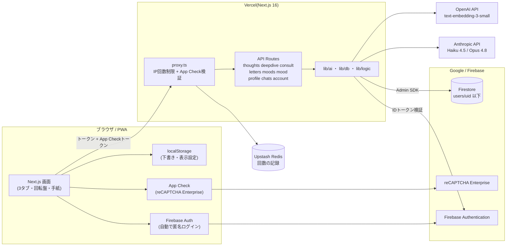

# 構成図：システム全体

ブラウザはFirestoreに直接つながない。すべて API Routes（Admin SDK）を通る。

出典：`docs/ARCHITECTURE.md`・`docs/SECURITY-SETUP.md`・`proxy.ts`・`firestore.rules`。
補足：App Check は現在 `monitor`（検証は記録するだけで拒否しない）。Firestore のセキュリティルールは全拒否。
