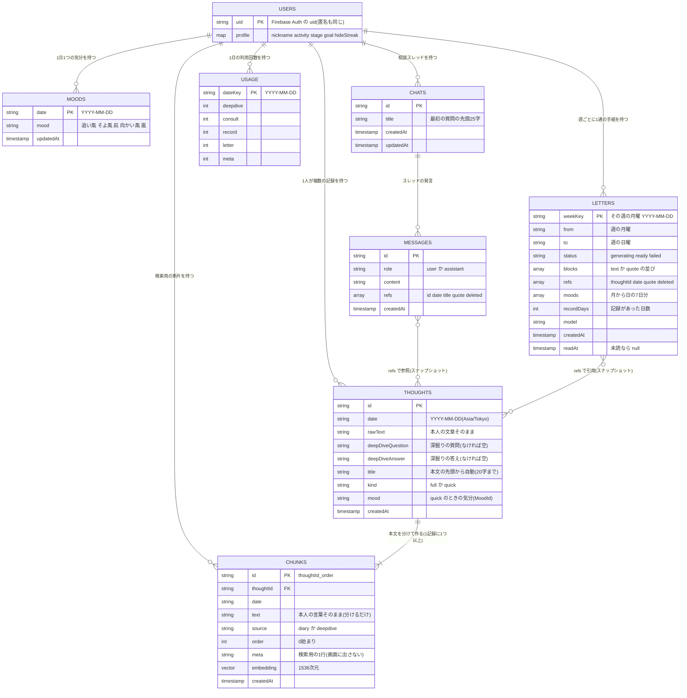

# ER図：Firestore のデータモデル

すべてのデータは `users/{uid}` の下にある。クライアントから Firestore へ直接は読み書きせず（`firestore.rules` は全拒否）、API Routes が Admin SDK で読み書きする。
`PK` は文書 ID、`FK` は別の文書 ID を指す項目。Firestore は外部キー制約を持たないので、関係はアプリが守る。

推測：なし。型は `lib/db/types.ts`、保存先は各 API Route のコードから起こした。
補足：
- `THOUGHTS` には、移行完了まで旧6項目（event・thinking・action・reason・emotion・values）と旧 embedding が残る。図からは省いた。
- 記録を消すと、そのチャンクも消え、手紙・相談の `refs` は `deleted: true` で引用を伏せる（憲法第13条）。
- 下書きはサーバーに送らず、端末の localStorage だけにある。
