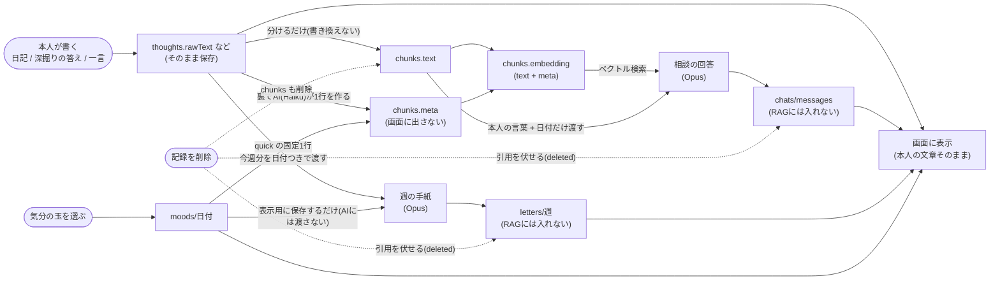

# データ遷移図：本人の言葉が、どこへ流れ、どこに出るか

「本人の言葉」を一字も変えずに通す経路と、AI に渡してよいもの・渡さないものを分けて示す。

推測：なし。`docs/AI-CONSTITUTION.md`（第4・12・13条）・`docs/ARCHITECTURE.md`・各 API Route から起こした。
補足：AI に渡さないもの＝気分・メタ・題・自動の呼び名。危機の言葉の判定（`lib/logic/crisis.ts`）はAIを通らない経路にも掛かる（図には入れていない）。
