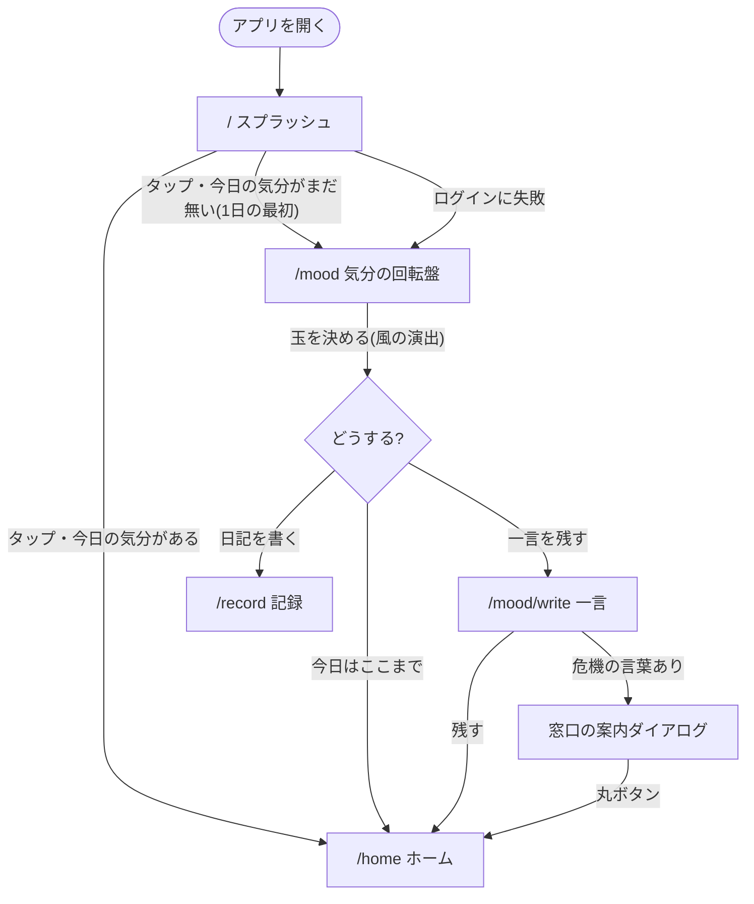

# 画面遷移図①：起動と気分の流れ

アプリを開いてから、ホームに着くまで。1日の最初だけ気分の回転盤を通る。矢印のラベルは「押したもの／起きたこと」。

出典：`components/splash/Splash.tsx`（`nextRoute`・`authError` の分岐）、`app/mood/page.tsx`、`app/mood/write/page.tsx`。「1日の最初」は、今日の気分が無く、端末に記録した日付が今日でないとき。
