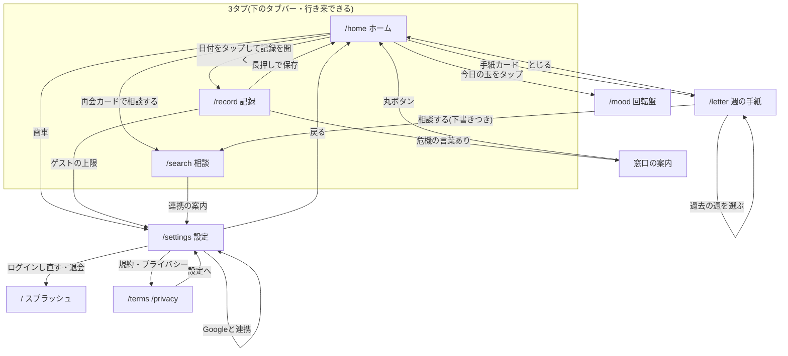

# 画面遷移図②：3タブと、まわりの画面

ホーム・記録・相談の3タブは、下のタブバーで行き来する。そこから出ていく画面と、戻る先を示す。

推測：「ログインし直す・退会」の行き先は `AccountCard.tsx` の `router.replace("/")` による。`/onboarding` は `/settings` へ転送するだけ、`/dev-login` は開発用なので省いた。
