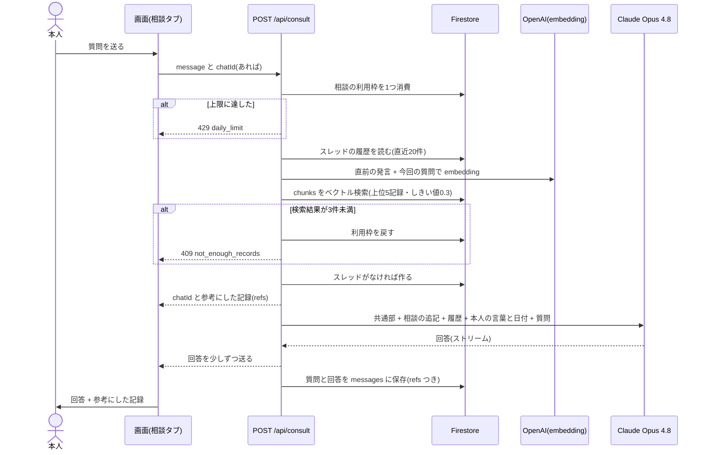

# シーケンス図：相談（過去の自分の記録を根拠に答える）

AI に渡すのは、本人の言葉のチャンク（日付つき）と相談の文だけ。気分・メタ・題・呼び名は渡さない。

出典：`app/api/consult/route.ts`・`docs/DEVELOPMENT.md`（フォールバック）。
補足：
- チャンクがない人は、旧 `thoughts.embedding` の検索にフォールバックする。
- 失敗したときは利用枠を戻し、作ったばかりの空のスレッドは消す。
- 会話（`messages`）は RAG に入れない。
