# シーケンス図：週の手紙（開いたときに生成）

スケジューラは使わない。手紙を開いたときに生成を始め、画面を閉じても裏で最後まで続く。

```mermaid
sequenceDiagram
    actor U as 本人
    participant C as 画面(手紙)
    participant API as /api/letters/current
    participant DB as Firestore
    participant M as Claude Opus 4.8

    U->>C: ホームの手紙カードをタップ
    C->>API: GET
    API->>DB: 今週の手紙を読む
    API-->>C: ready / generating / none / locked
    alt none(まだ書かれていない)
        C->>API: POST
        API->>API: 開ける週か(日曜から翌土曜) / 記録が3日以上か
        API->>DB: 手紙の利用枠を1つ消費
        API->>DB: トランザクションで generating にする(二重生成を防ぐ)
        API-->>C: 202 generating
        Note over API,M: 応答のあと after() で最後まで続ける
        API->>M: 共通部 + 手紙の追記 + 今週の記録(日付つき・本人の言葉)
        M-->>API: 手紙の本文
        API->>API: 引用が本人の文章の部分文字列かを検証
        alt 成功
            API->>DB: ready で保存(今週の玉も一緒に)
        else 失敗かつ危機の言葉のある週
            API->>DB: 固定文の手紙(窓口の案内)を保存
        else 失敗
            API->>DB: 作りかけの手紙を消して利用枠を戻す
        end
        loop 4秒ごとに GET
            C->>API: GET
            API-->>C: generating
        end
        C->>API: GET
        API-->>C: ready と手紙
    end
    C->>U: 封が開く → 便箋
```

出典：`app/api/letters/current/route.ts`・`lib/db/letterStore.ts`・`lib/db/useLetter.ts`（再取得の間隔 4000ms）。
補足：
- 開けない週は 409 `not_available`、記録が3日未満は 409 `too_few_records`（AI は呼ばない）。
- 失敗かつ危機の言葉のない週は、固定文の手紙は作らず、手紙を消して枠を戻す。次に開いたときにもう一度作る。
- 生成中のまま6分以上止まった手紙は、次の POST で作り直す（前の生成が使った枠を戻す）。
- 別のタブが先に作っていた場合は、利用枠を戻して、その手紙を返す。
