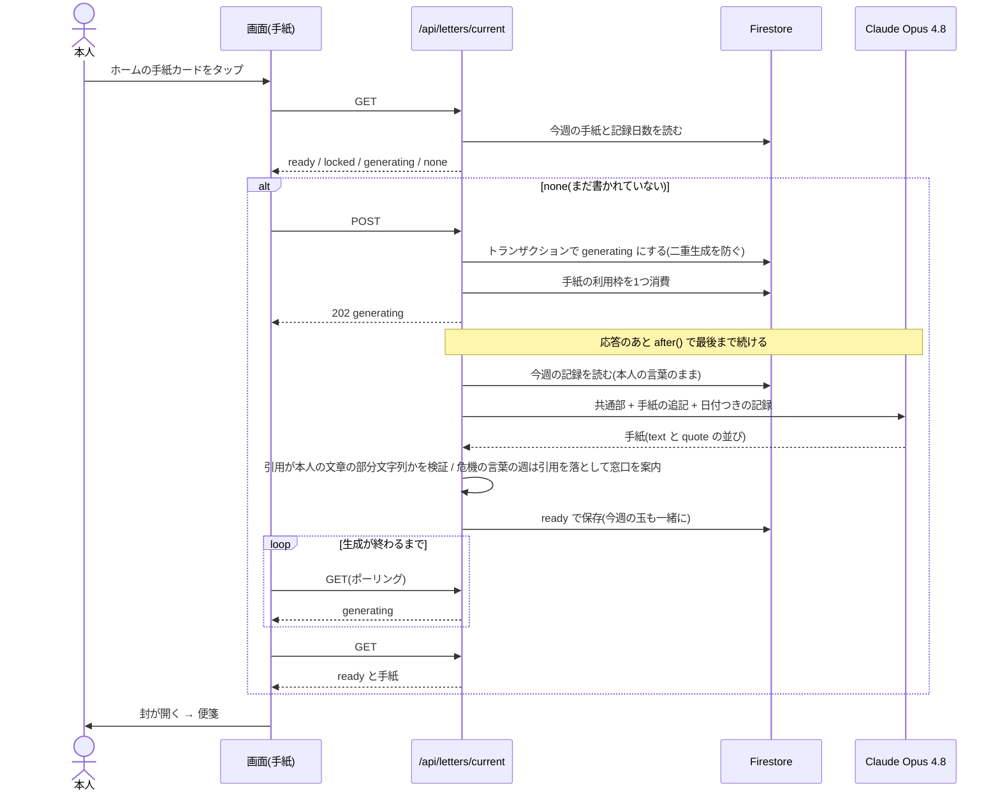

# シーケンス図：週の手紙（開いたときに生成）

スケジューラは使わない。手紙を開いた1回目に生成を始め、画面を閉じても裏で最後まで続ける。

推測：「ポーリング」の間隔は画面側（`useLetter.ts`）による。本図では省いた。
補足：
- 今週3日以上の記録がないと `locked`（AI は呼ばない）。
- AI が使えない週（refusal・max_tokens・失敗）は、エラーではなく固定文の手紙（窓口の案内）を届ける。
- 止まった生成（6分超）は、作り直して前の利用枠を戻す。
