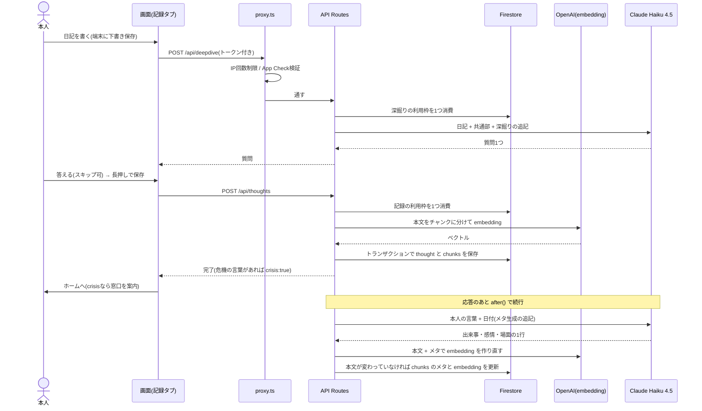

# シーケンス図：記録の保存（日記 → 深掘り → 保存 → 裏でメタ）

本人の文章は書き換えず、そのまま `thoughts` に保存する。検索用の1行メタは、保存の応答を返したあとに裏で作る。

推測：なし。`app/api/deepdive/route.ts`・`app/api/thoughts/route.ts`・`lib/db/chunkStore.ts` から起こした。
補足：
- 一言（`quick`）はAIを呼ばず、気分から作った固定の1行をメタに入れる。裏のメタ生成は `full` だけ。
- 上限に達した日は、深掘りを飛ばして保存だけできる。
- 過去日に書いた記録は、その日にすでに記録があると 409（`date_taken`）で断る。
