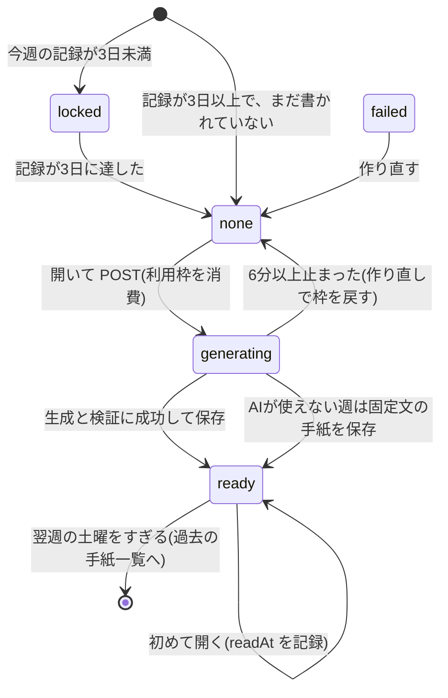

# 状態遷移図：手紙（`letters/{weekKey}` と画面の状態）

画面が受け取る状態は `locked / none / generating / ready`。保存される `status` は `generating / ready / failed`。

推測：`failed` が作られる経路は、コード上は「失敗した手紙は未作成として扱う」（GET/POST が none とみなす）扱い。`failed → none` はその説明のための矢印。
