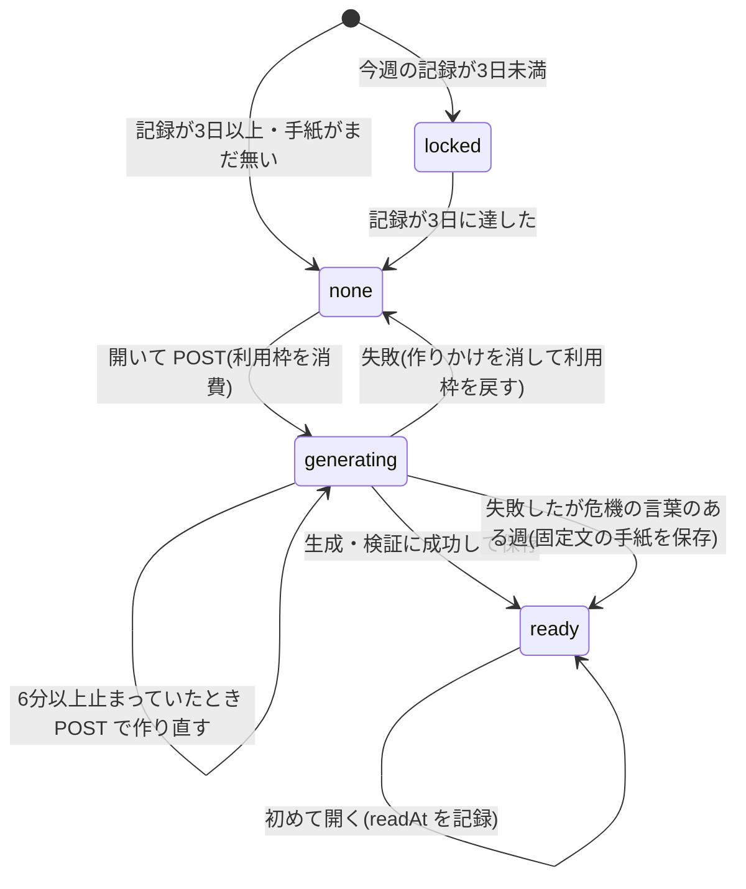

# 状態遷移図：手紙（`letters/{weekKey}` と画面の状態）

画面が受け取る状態は `locked / none / generating / ready`。手紙のドキュメントに保存されるのは `generating` と `ready` のとき。

出典：`app/api/letters/current/route.ts`（GET・POST・`generateLetter`）、`lib/db/letterStore.ts`（`decideBegin`・`GENERATING_STALE_MS` = 6分）。
補足：`LetterStatus` の型には `failed` があるが、コードのどこにも `failed` を書き込む処理は無い（保存値が未知のときの読み取りの既定値としてだけ使われる）。そのため図には入れていない。
